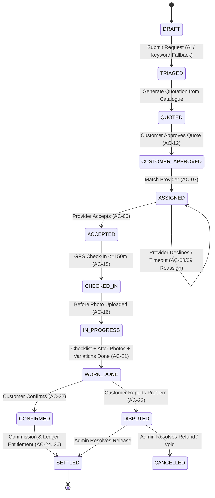

# HomeServe Masterpiece MVP: Engineering Blueprint
## State Machines, Database Schema, API Contracts & Automated Test Specification

> **Companion Document to:** [`docs/MVP_ACCEPTANCE_CRITERIA.md`](file:///e:/My%20AI%20BOTs%20for%20Sale/Home-Services-AI-Model-push/docs/MVP_ACCEPTANCE_CRITERIA.md)  
> **Target Standard:** Deterministic, Mechanical Pass/Fail Acceptance (Zero Manual Database Manipulation)  
> **Architecture Level:** Masterpiece Baseline (FastAPI + SQLite/PostgreSQL Ready)

---

## 1. State Machine Architecture (FSMs)

To guarantee that no transaction gets stuck or bypasses validation, the system implements 6 formal, deterministic Finite State Machines with explicit guard conditions.



### 1.1 Job Lifecycle FSM & Transitions

| From State | Event / Action | Guard Condition | To State | Target AC |
| :--- | :--- | :--- | :--- | :--- |
| `draft` | `submit_request` | Valid description, property ID, accepted terms | `triaged` | AC-01, AC-03 |
| `triaged` | `generate_quote` | Authoritative catalogue item linked or scope priced | `quoted` | AC-10, AC-11 |
| `quoted` | `customer_approve` | Customer digital approval with quote version & total | `customer_approved` | AC-12, AC-13 |
| `customer_approved` | `auto_assign` | Active, verified provider matching category & area | `assigned` | AC-05, AC-07 |
| `assigned` | `provider_decline` | Explicit decline action | `unassigned` / `reassigned` | AC-08 |
| `assigned` | `timeout_expired` | Clock > assigned_at + timeout_minutes (10 min) | `unassigned` / `reassigned` | AC-09 |
| `assigned` | `provider_accept` | Assigned provider accepts within timeout window | `accepted` | AC-06, AC-14 |
| `accepted` | `arrival_check_in` | Provider GPS accuracy <= 150m | `checked_in` | AC-15 |
| `checked_in` | `upload_before_photos` | At least 1 before-work photo uploaded | `in_progress` | AC-16 |
| `in_progress` | `mark_work_done` | Checklist 100% complete, after-photos uploaded, no pending extra work | `work_done` | AC-17, AC-20, AC-21 |
| `work_done` | `customer_confirm` | Customer confirms & rates provider | `confirmed` | AC-22, AC-29 |
| `work_done` | `customer_dispute` | Customer enters dispute reason | `disputed` | AC-23, AC-31 |
| `work_done` | `auto_confirm_timer` | 24 hours elapsed without customer dispute | `confirmed` | AC-22 |
| `confirmed` | `settle_transaction` | Ledger transaction created: Provider Entitlement + Commission | `settled` | AC-24, AC-25, AC-26 |
| `disputed` | `admin_resolve_release`| Admin dispute resolution with audit note | `settled` | AC-31, AC-33 |
| `disputed` | `admin_resolve_cancel` | Admin cancels job with refund/void | `cancelled` | AC-31, AC-33 |

### 1.2 Provider Assignment Offer FSM
* `OFFERED`: Job assigned to provider; countdown timer active.
* `ACCEPTED`: Provider accepted; contact unlocked.
* `DECLINED`: Provider rejected; recorded in audit history; job goes to next candidate.
* `EXPIRED`: Provider didn't respond within 10 minutes; recorded in audit history; job re-dispatched.

### 1.3 Variation / Extra Work FSM
* `PROPOSED`: Provider requests additional scope & price + mandatory reason. Base price remains untouched.
* `APPROVED`: Customer explicitly approves; variation added to authorized work order total.
* `REJECTED`: Customer rejects; variation excluded from customer final charge.

### 1.4 Ledger & Payout FSM
* `ESCROW_HELD`: Customer funds / commitment held.
* `ENTITLED`: Customer confirmed; platform commission deducted; balance credited to provider ledger.
* `PAYOUT_RECORDED`: Admin records payout reference (JazzCash/Easypaisa/Bank). Payout reduces provider balance.

---

## 2. Authoritative Database Schema (DDL)

This schema upgrades the existing HomeServe SQLite database to satisfy all 36 Acceptance Criteria, enforcing referential integrity and audit trails.

```sql
-- ============================================================================
-- 1. CUSTOMERS & PROPERTIES (AC-01, AC-02)
-- ============================================================================
CREATE TABLE IF NOT EXISTS customers (
    id INTEGER PRIMARY KEY AUTOINCREMENT,
    name TEXT NOT NULL,
    phone TEXT UNIQUE NOT NULL,
    pin_hash TEXT NOT NULL,
    email TEXT,
    is_active INTEGER NOT NULL DEFAULT 1,
    created_at TEXT NOT NULL,
    updated_at TEXT NOT NULL
);

CREATE TABLE IF NOT EXISTS customer_properties (
    id INTEGER PRIMARY KEY AUTOINCREMENT,
    customer_id INTEGER NOT NULL,
    title TEXT NOT NULL,                -- e.g. "Home", "Office", "Rental Apt 2"
    area TEXT NOT NULL,                 -- e.g. "F-10", "G-11", "Bahria Phase 4"
    address TEXT NOT NULL,
    access_instructions TEXT DEFAULT '', -- Gate code, floor, guard details
    is_default INTEGER NOT NULL DEFAULT 0,
    created_at TEXT NOT NULL,
    updated_at TEXT NOT NULL,
    FOREIGN KEY(customer_id) REFERENCES customers(id) ON DELETE CASCADE
);
CREATE INDEX IF NOT EXISTS ix_properties_customer ON customer_properties(customer_id);

-- ============================================================================
-- 2. PROVIDERS & VERIFICATION (AC-05, AC-06, AC-07)
-- ============================================================================
CREATE TABLE IF NOT EXISTS technicians (
    id INTEGER PRIMARY KEY AUTOINCREMENT,
    name TEXT NOT NULL,
    phone TEXT UNIQUE NOT NULL,
    pin_hash TEXT NOT NULL,
    category TEXT NOT NULL,
    area TEXT NOT NULL DEFAULT '',
    skills_json TEXT DEFAULT '[]',       -- JSON list of sub-skills
    is_verified INTEGER NOT NULL DEFAULT 0, -- AC-05: Must be 1 to accept production jobs
    verification_notes TEXT DEFAULT '',
    available INTEGER NOT NULL DEFAULT 1,
    active INTEGER NOT NULL DEFAULT 1,
    rating REAL NOT NULL DEFAULT 5.0,
    rating_count INTEGER NOT NULL DEFAULT 0,
    jobs_done INTEGER NOT NULL DEFAULT 0,
    application_id INTEGER,
    created_at TEXT NOT NULL,
    updated_at TEXT NOT NULL
);
CREATE INDEX IF NOT EXISTS ix_techs_dispatch ON technicians(active, is_verified, available, category, area);

-- ============================================================================
-- 3. SERVICE CATALOGUE & CHECKLISTS (AC-10, AC-17, AC-32)
-- ============================================================================
CREATE TABLE IF NOT EXISTS service_catalog (
    id INTEGER PRIMARY KEY AUTOINCREMENT,
    category TEXT NOT NULL,
    service_name TEXT NOT NULL,
    description TEXT NOT NULL DEFAULT '',
    unit TEXT NOT NULL DEFAULT 'service', -- 'service', 'unit', 'point', 'hour'
    base_price REAL NOT NULL,
    visit_fee REAL NOT NULL DEFAULT 0,
    checklist_template_json TEXT NOT NULL DEFAULT '[]', -- List of checklist items
    warranty_days INTEGER NOT NULL DEFAULT 0,           -- AC-32: Warranty period in days
    active INTEGER NOT NULL DEFAULT 1,
    created_at TEXT NOT NULL,
    updated_at TEXT NOT NULL
);

-- ============================================================================
-- 4. SERVICE REQUESTS & AI TRIAGE (AC-03, AC-04)
-- ============================================================================
CREATE TABLE IF NOT EXISTS requests (
    id INTEGER PRIMARY KEY AUTOINCREMENT,
    token TEXT UNIQUE NOT NULL,
    customer_id INTEGER,                                -- AC-01 Link
    property_id INTEGER,                                -- AC-02 Link
    customer_name TEXT NOT NULL,
    customer_phone TEXT NOT NULL,
    address TEXT NOT NULL,
    area TEXT NOT NULL,
    description TEXT NOT NULL,
    preferred_time TEXT DEFAULT 'asap',
    urgency TEXT NOT NULL DEFAULT 'normal',             -- 'normal', 'urgent', 'emergency'
    category TEXT NOT NULL,
    ai_summary TEXT NOT NULL DEFAULT '',
    ai_confidence REAL DEFAULT 1.0,
    triage_method TEXT NOT NULL DEFAULT 'ai',           -- 'ai' or 'keyword_fallback' (AC-36)
    status TEXT NOT NULL DEFAULT 'new',
    technician_id INTEGER,
    assigned_at TEXT,
    arrival_checked_in_at TEXT,
    arrival_latitude REAL,
    arrival_longitude REAL,
    arrival_accuracy REAL,
    completed_at TEXT,
    confirmed_at TEXT,
    created_at TEXT NOT NULL,
    updated_at TEXT NOT NULL,
    FOREIGN KEY(customer_id) REFERENCES customers(id),
    FOREIGN KEY(property_id) REFERENCES customer_properties(id),
    FOREIGN KEY(technician_id) REFERENCES technicians(id)
);
CREATE INDEX IF NOT EXISTS ix_requests_status ON requests(status, category);

-- ============================================================================
-- 5. QUOTATIONS & WORK ORDERS (AC-11, AC-12, AC-13)
-- ============================================================================
CREATE TABLE IF NOT EXISTS quotations (
    id INTEGER PRIMARY KEY AUTOINCREMENT,
    request_id INTEGER NOT NULL,
    version INTEGER NOT NULL DEFAULT 1,
    service_id INTEGER,
    scope_summary TEXT NOT NULL,
    items_json TEXT NOT NULL DEFAULT '[]',   -- Breakdown: [{item, qty, unit_price, total}]
    base_amount REAL NOT NULL,
    visit_fee REAL NOT NULL DEFAULT 0,
    discount_amount REAL NOT NULL DEFAULT 0,
    total_amount REAL NOT NULL,
    warranty_days INTEGER NOT NULL DEFAULT 0,
    valid_until TEXT,
    status TEXT NOT NULL DEFAULT 'issued',   -- 'issued', 'approved', 'rejected', 'superseded'
    approved_at TEXT,
    approved_by_customer_id INTEGER,
    created_at TEXT NOT NULL,
    FOREIGN KEY(request_id) REFERENCES requests(id),
    FOREIGN KEY(service_id) REFERENCES service_catalog(id)
);

CREATE TABLE IF NOT EXISTS work_orders (
    id INTEGER PRIMARY KEY AUTOINCREMENT,
    request_id INTEGER UNIQUE NOT NULL,
    quotation_id INTEGER NOT NULL,
    customer_id INTEGER,
    technician_id INTEGER NOT NULL,
    property_id INTEGER,
    authorized_scope TEXT NOT NULL,
    authorized_price REAL NOT NULL,
    deadline_sla TEXT,
    evidence_requirements_json TEXT NOT NULL DEFAULT '{"require_before_photos":1,"require_after_photos":1,"require_checklist":1}',
    created_at TEXT NOT NULL,
    FOREIGN KEY(request_id) REFERENCES requests(id),
    FOREIGN KEY(quotation_id) REFERENCES quotations(id),
    FOREIGN KEY(technician_id) REFERENCES technicians(id)
);

-- ============================================================================
-- 6. DISPATCH, ASSIGNMENTS & DECLINES (AC-07, AC-08, AC-09)
-- ============================================================================
CREATE TABLE IF NOT EXISTS assignment_offers (
    id INTEGER PRIMARY KEY AUTOINCREMENT,
    request_id INTEGER NOT NULL,
    technician_id INTEGER NOT NULL,
    offered_at TEXT NOT NULL,
    expires_at TEXT NOT NULL,
    status TEXT NOT NULL DEFAULT 'pending', -- 'pending', 'accepted', 'declined', 'timeout'
    decline_reason TEXT DEFAULT '',
    responded_at TEXT,
    FOREIGN KEY(request_id) REFERENCES requests(id),
    FOREIGN KEY(technician_id) REFERENCES technicians(id)
);
CREATE INDEX IF NOT EXISTS ix_assignment_offers_active ON assignment_offers(request_id, status);

-- ============================================================================
-- 7. EXECUTION, CHECKLISTS & EVIDENCE (AC-15, AC-16, AC-17, AC-20)
-- ============================================================================
CREATE TABLE IF NOT EXISTS job_checklists (
    id INTEGER PRIMARY KEY AUTOINCREMENT,
    request_id INTEGER NOT NULL,
    item_label TEXT NOT NULL,
    is_completed INTEGER NOT NULL DEFAULT 0,
    completed_at TEXT,
    FOREIGN KEY(request_id) REFERENCES requests(id)
);

CREATE TABLE IF NOT EXISTS job_photos (
    id INTEGER PRIMARY KEY AUTOINCREMENT,
    request_id INTEGER NOT NULL,
    technician_id INTEGER NOT NULL,
    phase TEXT NOT NULL CHECK(phase IN ('before', 'after')),
    stored_path TEXT NOT NULL,
    media_type TEXT NOT NULL,
    uploaded_at TEXT NOT NULL,
    FOREIGN KEY(request_id) REFERENCES requests(id),
    FOREIGN KEY(technician_id) REFERENCES technicians(id)
);
CREATE INDEX IF NOT EXISTS ix_job_photos_req_phase ON job_photos(request_id, phase);

-- ============================================================================
-- 8. EXTRA WORK VARIATIONS (AC-18, AC-19)
-- ============================================================================
CREATE TABLE IF NOT EXISTS extra_charge_proposals (
    id INTEGER PRIMARY KEY AUTOINCREMENT,
    request_id INTEGER NOT NULL,
    technician_id INTEGER NOT NULL,
    amount REAL NOT NULL,
    reason TEXT NOT NULL,
    photo_id INTEGER,
    status TEXT NOT NULL DEFAULT 'pending', -- 'pending', 'approved', 'rejected'
    created_at TEXT NOT NULL,
    reviewed_at TEXT,
    FOREIGN KEY(request_id) REFERENCES requests(id),
    FOREIGN KEY(technician_id) REFERENCES technicians(id)
);

-- ============================================================================
-- 9. FINANCIALS, LEDGER & PAYOUTS (AC-24, AC-25, AC-26, AC-27)
-- ============================================================================
CREATE TABLE IF NOT EXISTS payments (
    id INTEGER PRIMARY KEY AUTOINCREMENT,
    request_id INTEGER UNIQUE NOT NULL,
    technician_id INTEGER NOT NULL,
    base_amount REAL NOT NULL,
    approved_variations REAL NOT NULL DEFAULT 0,
    discount_amount REAL NOT NULL DEFAULT 0,
    final_customer_amount REAL NOT NULL,    -- AC-24
    commission_pct REAL NOT NULL,
    commission_amount REAL NOT NULL,         -- AC-25
    provider_entitlement REAL NOT NULL,      -- AC-26
    collected INTEGER NOT NULL DEFAULT 0,
    status TEXT NOT NULL DEFAULT 'awaiting_confirmation', -- 'awaiting_confirmation', 'released', 'disputed', 'void'
    created_at TEXT NOT NULL,
    released_at TEXT,
    FOREIGN KEY(request_id) REFERENCES requests(id),
    FOREIGN KEY(technician_id) REFERENCES technicians(id)
);

CREATE TABLE IF NOT EXISTS provider_ledger (
    id INTEGER PRIMARY KEY AUTOINCREMENT,
    technician_id INTEGER NOT NULL,
    transaction_type TEXT NOT NULL,          -- 'JOB_ENTITLEMENT', 'PAYOUT', 'ADJUSTMENT'
    amount REAL NOT NULL,                    -- Positive for credit, negative for debit
    balance_after REAL NOT NULL,             -- Provable verifiable balance
    source_request_id INTEGER,
    payout_record_id INTEGER,
    notes TEXT DEFAULT '',
    created_at TEXT NOT NULL,
    FOREIGN KEY(technician_id) REFERENCES technicians(id)
);
CREATE INDEX IF NOT EXISTS ix_ledger_tech ON provider_ledger(technician_id, id);

CREATE TABLE IF NOT EXISTS payout_records (
    id INTEGER PRIMARY KEY AUTOINCREMENT,
    technician_id INTEGER NOT NULL,
    amount REAL NOT NULL,
    payment_method TEXT NOT NULL,            -- 'JazzCash', 'Easypaisa', 'Bank Transfer'
    reference_number TEXT NOT NULL,          -- Bank/Wallet transaction reference
    recorded_by_admin TEXT NOT NULL,
    status TEXT NOT NULL DEFAULT 'completed',
    created_at TEXT NOT NULL,
    FOREIGN KEY(technician_id) REFERENCES technicians(id)
);

-- ============================================================================
-- 10. INVOICES, RATINGS & DISPUTES (AC-28, AC-29, AC-31, AC-32)
-- ============================================================================
CREATE TABLE IF NOT EXISTS invoices (
    id INTEGER PRIMARY KEY AUTOINCREMENT,
    invoice_number TEXT UNIQUE NOT NULL,     -- e.g. "INV-2026-0001"
    request_id INTEGER UNIQUE NOT NULL,
    customer_id INTEGER,
    property_id INTEGER,
    line_items_json TEXT NOT NULL,
    total_amount REAL NOT NULL,
    payment_status TEXT NOT NULL DEFAULT 'paid_or_settled',
    warranty_expiry_date TEXT,
    issued_at TEXT NOT NULL,
    FOREIGN KEY(request_id) REFERENCES requests(id)
);

CREATE TABLE IF NOT EXISTS ratings (
    id INTEGER PRIMARY KEY AUTOINCREMENT,
    request_id INTEGER UNIQUE NOT NULL,
    customer_id INTEGER,
    technician_id INTEGER NOT NULL,
    score INTEGER NOT NULL CHECK(score BETWEEN 1 AND 5),
    feedback TEXT DEFAULT '',
    created_at TEXT NOT NULL,
    FOREIGN KEY(request_id) REFERENCES requests(id),
    FOREIGN KEY(technician_id) REFERENCES technicians(id)
);

CREATE TABLE IF NOT EXISTS disputes (
    id INTEGER PRIMARY KEY AUTOINCREMENT,
    request_id INTEGER UNIQUE NOT NULL,
    customer_id INTEGER,
    technician_id INTEGER NOT NULL,
    reason TEXT NOT NULL,
    status TEXT NOT NULL DEFAULT 'open',     -- 'open', 'resolved_released', 'resolved_refunded'
    resolution_notes TEXT DEFAULT '',
    resolved_by_admin TEXT,
    created_at TEXT NOT NULL,
    resolved_at TEXT,
    FOREIGN KEY(request_id) REFERENCES requests(id)
);

CREATE TABLE IF NOT EXISTS warranty_claims (
    id INTEGER PRIMARY KEY AUTOINCREMENT,
    original_request_id INTEGER NOT NULL,
    customer_id INTEGER NOT NULL,
    claim_reason TEXT NOT NULL,
    is_valid INTEGER NOT NULL DEFAULT 1,     -- Computed against original catalog warranty_days
    status TEXT NOT NULL DEFAULT 'submitted', -- 'submitted', 'assigned', 'resolved'
    created_at TEXT NOT NULL,
    FOREIGN KEY(original_request_id) REFERENCES requests(id)
);

-- ============================================================================
-- 11. AUDIT TRAIL & OPERATIONAL TRACKING (AC-33, AC-35)
-- ============================================================================
CREATE TABLE IF NOT EXISTS audit_log (
    id INTEGER PRIMARY KEY AUTOINCREMENT,
    actor_role TEXT NOT NULL,                -- 'customer', 'provider', 'admin', 'system'
    actor_id TEXT NOT NULL,                  -- ID or key of caller
    action TEXT NOT NULL,                    -- e.g. 'quote_approved', 'check_in', 'extra_work_approved'
    entity_type TEXT NOT NULL,               -- 'request', 'payment', 'technician', etc.
    entity_id INTEGER NOT NULL,
    details_json TEXT DEFAULT '{}',
    ip_address TEXT,
    created_at TEXT NOT NULL
);
CREATE INDEX IF NOT EXISTS ix_audit_entity ON audit_log(entity_type, entity_id);
```

---

## 3. Formal API Contracts Specification

### 3.1 Authentication & Role Isolation (AC-34)
* **Customer Headers**: `Authorization: Bearer <customer_jwt_or_token>` or `X-Customer-Phone: <phone>` + `X-Customer-Pin: <pin>`
* **Provider Headers**: `X-Phone: <technician_phone>`, `X-Pin: <technician_pin>`
* **Admin Headers**: `X-Admin-Key: <strong_admin_key>`
* **Cross-Role Violation**: Any customer calling `/api/admin/*` or `/api/tech/*` receives `403 Forbidden` or `401 Unauthorized`. Any provider calling unassigned customer details receives sanitized data (`AC-14`).

### 3.2 Endpoint Matrix

| Method | Endpoint | Role | Description | Target AC |
| :--- | :--- | :--- | :--- | :--- |
| `POST` | `/api/customer/register` | Public | Register customer account | AC-01 |
| `POST` | `/api/customer/login` | Public | Login customer & issue session | AC-01 |
| `POST` | `/api/customer/properties` | Customer | Add property with address & area | AC-02 |
| `GET`  | `/api/customer/properties` | Customer | List customer properties | AC-02 |
| `POST` | `/api/requests` | Customer | Create service request with property | AC-03, AC-04 |
| `GET`  | `/api/catalog` | Public | View services, prices, warranties | AC-10 |
| `POST` | `/api/requests/{id}/quotation` | Admin/Sys | Generate itemized quote from catalog | AC-11 |
| `POST` | `/api/requests/{id}/approve-quote` | Customer | Explicitly approve quote & price | AC-12, AC-13 |
| `POST` | `/api/tech/jobs/{id}/accept` | Provider | Accept offer; unlock customer data | AC-06, AC-14 |
| `POST` | `/api/tech/jobs/{id}/decline` | Provider | Decline offer; triggers re-dispatch | AC-08 |
| `POST` | `/api/tech/jobs/{id}/check-in` | Provider | GPS check-in (<=150m) | AC-15 |
| `POST` | `/api/tech/jobs/{id}/photos/{phase}` | Provider | Upload 'before' or 'after' photo | AC-16, AC-20 |
| `POST` | `/api/tech/jobs/{id}/checklist` | Provider | Mark required checklist item done | AC-17 |
| `POST` | `/api/tech/jobs/{id}/extra-work`| Provider | Propose extra work variation | AC-18 |
| `POST` | `/api/track/{token}/extra-charges/{id}/decision` | Customer | Approve or reject variation | AC-19 |
| `POST` | `/api/tech/jobs/{id}/done` | Provider | Submit job as completed | AC-21 |
| `POST` | `/api/track/{token}/confirm` | Customer | Confirm & rate provider | AC-22, AC-29 |
| `POST` | `/api/track/{token}/dispute` | Customer | File dispute; halts payout | AC-23, AC-31 |
| `GET`  | `/api/track/{token}/invoice` | Customer | Generate/download invoice | AC-28 |
| `GET`  | `/api/tech/ledger` | Provider | Ledger-backed balance & transactions | AC-26 |
| `POST` | `/api/admin/payouts` | Admin | Record manual payout (JazzCash/etc) | AC-27 |
| `GET`  | `/api/admin/disputes/{id}/package` | Admin | One-stop Dispute Evidence Package | AC-31 |
| `POST` | `/api/customer/warranty-claim` | Customer | Claim warranty against original job | AC-32 |
| `GET`  | `/api/admin/stuck-jobs` | Admin | List jobs stuck/overdue in any state | AC-35 |
| `GET`  | `/api/admin/audit-trail` | Admin | Query immutable audit log | AC-33 |

---

## 4. Operational Gap Analysis (Current v1 vs. MVP Criteria)

| Category | Criteria | Current v1 Status in `main.py` | Required MVP Enhancement |
| :--- | :--- | :--- | :--- |
| **Customer** | AC-01, AC-02 | Anonymous token-based intake; no customer table or saved properties. | Add `customers` and `customer_properties` tables + auth & property CRUD. |
| **AI Triage** | AC-03, AC-04, AC-36 | Fully working with Ollama + `keyword_guess` fallback. | Maintain existing fallback; add property association. |
| **Provider** | AC-05, AC-06 | Provider application + admin review exists. Unverified gate exists partially. | Strictly enforce `is_verified=1` check in `pick_technician` dispatch engine. |
| **Assignment** | AC-07, AC-08, AC-09 | Auto-assignment, decline tracking, and 10-minute sweep exist. | Formalize `assignment_offers` table with explicit audit logging. |
| **Scope & Quote**| AC-10, AC-11, AC-12 | Basic `service_catalog` exists; quote is direct price copy. | Add itemized `quotations` table + explicit digital approval endpoint before assignment. |
| **Execution** | AC-13..AC-17 | Check-in GPS <=150m exists. Before/after photos exist. | Add service-specific checklist enforcement table `job_checklists`. |
| **Variations** | AC-18, AC-19 | `extra_charge_proposals` with customer approval exists. | Enforce that only approved extra charges enter final calculation. |
| **Completion** | AC-20, AC-21 | Checks GPS, before/after photos, pending extra charges. | Add checklist 100% completion check before allowing `work_done`. |
| **Finance** | AC-24..AC-27 | Single-column `wallet` update in `technicians`. | Replace mutable `wallet` with double-entry `provider_ledger` + `payout_records`. |
| **Invoice** | AC-28 | No formal invoice record. | Add itemized `invoices` generator matching approved quote + variations. |
| **Disputes** | AC-31, AC-32 | Dispute flag sets `status='disputed'`. | Add dedicated `Dispute Evidence Package` aggregator + `warranty_claims`. |
| **Audit** | AC-33 | `events` table has text logs. | Upgrade to structured `audit_log` with actor, action, diff, and timestamp. |

---

## 5. Automated Verification Test Suite Specification

To guarantee the release rule (**100% Critical Criteria Passing**), an automated test runner executes the 22-step scenario mechanically:

### AC-46 End-to-End Mechanical Test Scenario
* **Input Text**: `"Kitchen ka nal leak ho raha hai."`
* **Area**: `F-10`
* **Test Sequence**:
  1. Register customer & add property in `F-10` (AC-01, AC-02).
  2. Create request; assert AI/fallback yields `Plumbing` & urgency (AC-03, AC-04).
  3. Verify catalogue item for plumbing with checklist (AC-10).
  4. Generate and customer-approve quotation (AC-11, AC-12, AC-13).
  5. Dispatch to verified plumber; assert unverified plumber skipped (AC-05, AC-07).
  6. Plumber accepts; assert customer details unlocked (AC-06, AC-14).
  7. Plumber GPS arrival check-in recorded (AC-15).
  8. Upload before-photo & verify work done blocked without it (AC-16).
  9. Complete plumbing checklist (AC-17).
  10. Plumber uploads after-photo & marks work done (AC-20, AC-21).
  11. Customer confirms & rates 5 stars (AC-22, AC-29).
  12. Verify calculations: `Base + Variations - Commission = Entitlement` (AC-24, AC-25).
  13. Assert ledger entry created with verifiable balance (AC-26).
  14. Admin records payout via JazzCash; verify balance reduction (AC-27).
  15. Assert invoice generated with matching total (AC-28).
  16. Assert complete audit trail exists for all steps (AC-33).
  17. **PASS / FAIL Outcome**: Assert zero manual database intervention.
